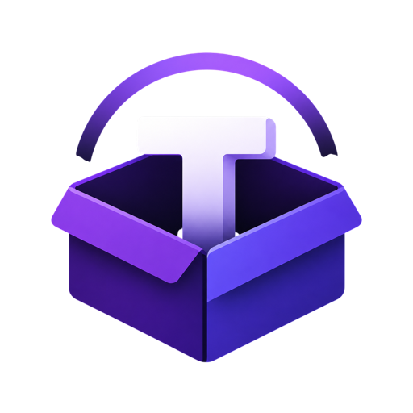

<div align="center">
  
  <h1>MyTorbox</h1>
  <p>Browse your TorBox library as Movie and Series catalogs in Stremio and Nuvio.</p>

  <a href="https://github.com/hackerslash/mytorbox/actions/workflows/deploy-deno.yml"></a>
  
  
  
</div>

---

A [Stremio](https://www.stremio.com/) addon that turns your [TorBox](https://torbox.app/) torrents and web downloads into browsable catalogs, matched against [TMDB](https://www.themoviedb.org/) for posters and metadata. Keys live in your install URL, not on the server.

**Hosted instance:** [mytorbox.hackerslash.dev/configure](https://mytorbox.hackerslash.dev/configure) — enter your keys and get an install link, no setup needed.

## Features

- **Library catalogs** — TorBox items grouped by title, season and episode, with filenames parsed and matched to TMDB.
- **Posters** — TMDB by default, [RPDB](https://ratingposterdb.com/) rated posters, or any IMDb-addressable poster URL pattern (e.g. `https://btttr.cc/poster/imdb/poster-default/{imdb_id}.jpg`; wins over RPDB).
- **Custom Streams** — pair a TMDB title (or your own) with a direct stream URL; it appears in a separate catalog and expires on its TTL. Needs `REDIS_URL`.
- **TMDB-only install** — leave the TorBox key empty to get just the Custom Streams catalogs.
- **Configure page** (`/configure`) — validates keys live and builds an install link for Stremio or Nuvio.
- **Stats dashboard** (`/stats`) — admin-only users, traffic, cache and library stats built from Redis keys. Needs `ADMIN_SECRET` and `REDIS_URL`.
- **Optional Jev matching** — with a [TypeSafe](https://typesafe.ai) key, ambiguous or missed titles are resolved instead of taking the first TMDB result.

## Usage

1. Get a [TMDB API key](https://www.themoviedb.org/settings/api), plus a [TorBox API key](https://torbox.app/settings) for your library and optionally an [RPDB key](https://ratingposterdb.com/api-key/).
2. Open `/configure`, enter the keys, click **Generate Install Link**.
3. Click **Install in Stremio**, or paste the manifest URL into Nuvio (`Settings → Addons → Add Addon`).

## Self-hosting

```bash
npm install
cp .env.example .env   # fill in values
npm run dev            # or: npm start
npm test
```

Open `http://localhost:7000/configure`. It runs as a plain Node server, so any container/VM host works; add Redis (e.g. Upstash) for Custom Streams and shared library caching. The public instance redeploys to [Deno Deploy](https://deno.com/deploy) on every push to `main` via `.github/workflows/deploy-deno.yml` (needs the `DENO_DEPLOY_TOKEN` secret).

## Configuration

All variables are optional.

| Variable | Description |
| --- | --- |
| `TORBOX_API_KEY` / `TMDB_API_KEY` / `RPDB_API_KEY` | Default keys used when the request URL carries none. If neither TorBox nor TMDB is set, every install must go through `/configure`. |
| `POSTER_URL` | Default poster URL pattern containing `{imdb_id}`. Takes precedence over RPDB. |
| `TYPESAFE_API_KEY` | Enables Jev title matching. Unset keeps first-result matching. |
| `ADDON_ACCESS_TOKEN` | When default keys are set, requires `?token=` on the bare addon URL so others can't use your account. |
| `PORT` | Listen port. Default `7000`. |
| `BASE_URL` | Public base URL for the manifest logo. Relative URLs if unset. |
| `REDIS_URL` | Library cache and Custom Streams. Without it the library is cached in-process and Custom Streams no-op. |
| `ADMIN_SECRET` | Unlocks `/stats` and `POST /api/cache/clear`. Unset means both return `503`. |
| `TRUST_PROXY_HOPS` | Reverse-proxy hops for correct client IPs in rate limiting. Default `1`. |
| `STATS_ENABLED` | `0` disables usage counters. On by default with Redis. |
| `STATS_FLUSH_SECONDS` | Counter flush interval to Redis. Default `60`. |

## Stats

`/stats` only serves a token prompt; the numbers come from `GET /api/stats`, which needs `ADMIN_SECRET` (`x-admin-secret` header or `Authorization: Bearer`), compares it in constant time, and is rate limited to 40 requests / 5 min per IP. Counters live under `st:*` with a ~31-day TTL, are buffered in-process and flushed as one pipeline every `STATS_FLUSH_SECONDS` (~30k Redis commands/day regardless of traffic). An unclean restart loses up to one interval. Only hashes are stored — never an API key, IP, IMDb id or filename.

## Security

The manifest URL encodes your API keys (base64url JSON) and is the only thing protecting your TorBox library — treat it like a password. Keys are never persisted; Redis entries are keyed by a SHA-256 hash of them. With `TYPESAFE_API_KEY` set, parsed titles, filenames and TMDB candidates for ambiguous matches are sent to TypeSafe's API.
